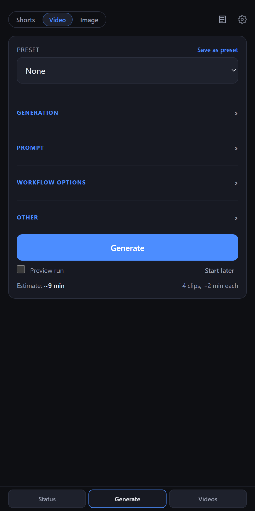
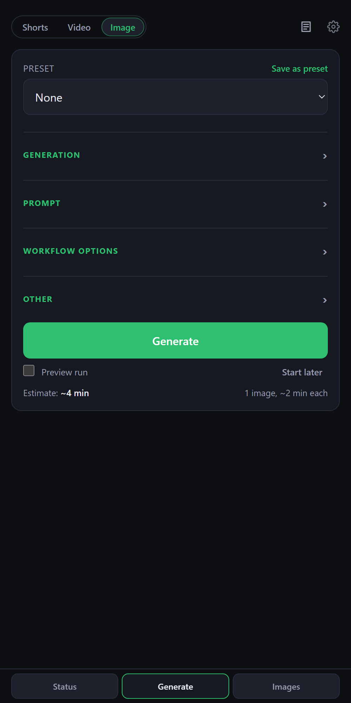

# gen-center

A self-hosted studio for AI video and image generation. One web panel drives ComfyUI through three pipelines:
**Shorts**, **Video** and **Image**. It writes the prompts, queues the work on your GPU, recovers from crashes, and
shows the results in a gallery you can use from a desktop or a phone.

| | Shorts | Video | Image |
|---|---|---|---|
| Makes | Vertical YouTube Shorts from a topic: AI script, narration, stock footage and a lip-synced AI presenter | A film from one image and a prompt, from a single 5-second clip up to 10 minutes | Sets of up to 100 images, from text or by editing images you give it |
| Audio | Always narrated | None, an uploaded file, or text to speech | None |
| Workflows | Those saved in ComfyUI ending in `_shorts` | Every other workflow saved in ComfyUI | Those saved in ComfyUI starting `image_` |
| Publishing | Uploads to YouTube | Download | Download |
| Details | [docs/shorts.md](docs/shorts.md) | [docs/video.md](docs/video.md) | [docs/image.md](docs/image.md) |

## Screenshots

On a desktop, Status, Generate and the finished films or images sit side by side:


On a phone, one section shows at a time, and you swipe between them:

<p>
  
  
</p>

## What it can do

### Generation

- **YouTube Shorts, start to finish.** Gemini picks a topic and writes the script, Gemini TTS narrates it, stock
  footage comes from Pexels or Pixabay, ComfyUI generates a lip-synced presenter, and ffmpeg edits it all together
  with transitions and silence removal. The finished Short can upload to YouTube by itself.
- **Films from an image.** An LLM looks at the image and writes a prompt for every shot. You can read and edit the shot
  list before rendering. ComfyUI renders each clip (LTX-2.3, MiniMax H3, Wan) and ffmpeg joins them.
- **Image sets.** Text to image, image to image, edit, inpaint, outpaint (expand) and "new picture from references".
  Supports Krea-2, Qwen-Image 2.1, MiniMax H3, Fibo and any other workflow you save in ComfyUI.
- **Inpainting editor.** Paint what to change, or click an object to select all of it (MobileSAM on the CPU). Give
  each colour its own prompt.
- **Prompt writing.** Gemini or a local model (Gemma, Qwen) writes one prompt per image or shot from a short brief, or
  your own prompt is used word for word. **Write prompt** rewrites a rough idea into a detailed prompt.
- **Comparisons.** Generate side-by-side sets that vary one thing on a fixed seed: LoRA strength across its range,
  every style LoRA, each model, text encoder or VAE file, every workflow, or each prompt-writing LLM.
- **LoRA stacks.** Add several LoRAs, each with its own strength. The suggested range comes from our own tests and the
  author's recommendation.

### Workflows and settings

- **Works with your own ComfyUI workflows.** The panel reads the workflows you save in ComfyUI and builds its form from
  their settings: sampler, resolution, LoRAs, model files and so on. New model files show up in the pickers as soon as
  you drop them into ComfyUI's folders.
- **Presets** save any combination of settings and can be favourited. Each finished run remembers exactly what it was
  made with, so you can open it again or continue it.

### Queue and reliability

- **One shared GPU queue** for all three pipelines. Reorder it, sort it by estimated time, pause and resume it, or put
  a job at the top. Time estimates are learned from your own past runs.
- **Never pays twice.** Runs save checkpoints, so a stopped or failed run continues where it left off and only redoes
  what you changed.
- **Crash recovery.** A hung or crashed ComfyUI is detected, restarted, and the job is retried. Interrupted work comes
  back on hold after a restart instead of being lost.
- **API quota tracking.** When a provider says a model is used up for the day, every run moves to the next model until
  it resets.
- **GPU housekeeping.** Between jobs, ComfyUI unloads its models and frees VRAM so the next job or local LLM has room.
  Optional low process priority, RAM reserve, and auto-shutdown when the queue is empty.
- **GPU temperature watch.** If the GPU passes 78°C, the panel restarts MSI Afterburner once to recover fan control.

### The panel

- **Desktop and phone.** A responsive layout with swipe navigation, pinch-to-zoom image viewer, and instant feedback
  when you delete or move something.
- **Reachable anywhere** through Tailscale, with password sign-in.
- **Gallery** with collections, drag-to-arrange batches, downloads, and generated titles.
- **Live status** over a compressed event stream: progress, ETA, and a log grouped by stage.
- **Local chat** with the local LLMs. Conversations are saved on the server, so they are the same on every device.
- **16 themes**, saved for every device.

## Technologies

| Area | Used |
|---|---|
| Backend | Python 3.11+, Flask, Server-Sent Events with gzip streaming, pydantic |
| Frontend | Plain JavaScript, HTML and CSS, no build step |
| Generation | ComfyUI over its HTTP and WebSocket API (`websocket-client`), PyTorch on the ComfyUI side |
| Models | LTX-2.3, MiniMax H3, Wan, Krea-2, Qwen-Image 2.1, Fibo; local LLMs Gemma 4 and Qwen3 running inside ComfyUI |
| Cloud AI | Google Gemini (`google-genai`) for scripts, prompts, titles and text to speech; Edge TTS |
| Media | FFmpeg (`ffmpeg-python`), Pillow, mutagen |
| Computer vision | MediaPipe (lip-sync checks), ONNX Runtime with MobileSAM (click-to-select), NumPy |
| External APIs | YouTube Data API (OAuth), Pexels, Pixabay |
| System | psutil (processes and priority), Tailscale (remote access), Windows shortcuts in PowerShell |
| Testing | `unittest` with a fake ComfyUI and Gemini, Node page checks, Playwright with headless Chromium, GitHub Actions on Windows (Python 3.11 and 3.13) |

## Setup

You need Python 3.11+, ffmpeg on the PATH, and ComfyUI with the models your workflows use.

```
pip install -r requirements.txt
cp .env.example .env
```

Fill in `.env`. `APP_PASSWORD` lets you reach the panel from a phone. `COMFYUI_LAUNCHER` lets the panel start ComfyUI.

For local LLMs and verified cleanup between jobs, install the ComfyUI integration with
`python scripts/install_comfy_cleanup.py` (or supply `--comfy-root`), then restart ComfyUI when it's idle.

For the Windows x64 / Python 3.13 baseline, pinned versions are in `constraints-windows-py313.txt`:

```
python -m pip install -r requirements.txt -c constraints-windows-py313.txt
python -m pip check
```

## Running it

```
powershell -ExecutionPolicy Bypass -File scripts/create_shortcut.ps1
```

That makes a **gen-center** shortcut, which starts the panel and opens it at http://localhost:8800. `/shorts`,
`/video` and `/image` open each side directly. **Shut down** in Settings stops it. Or run
`python webapp.py --host 0.0.0.0 --port 8800`.

Add `-Startup` to the shortcut script to start the panel when you sign in to Windows.

**From your phone, anywhere:** install [Tailscale](https://tailscale.com/download) on this PC and your phone and sign
in to the same account on both. Settings shows the address to open on your phone (`http://100.x.y.z:8800`).

Each pipeline also runs on its own from the command line: `python -m pipelines.shorts.main --help`,
`python -m pipelines.video.main --help` and `python -m pipelines.image.main --help`.

## Layout

```
core/         shared by the pipelines: Gemini calls, API usage and quota, voice, saved workflows
pipelines/    shorts/, video/ and image/, each with its own command line, runs and ETA
panel/        the web app: server.py, one module per side, and the frontend in static/ and templates/
workflows/    the built-in workflows
docs/         each pipeline in detail
logs/         usage, errors, topics and timings
models/       models the panel runs itself on the CPU: python scripts/get_models.py
runs/         saved progress, by pipeline
output/       shorts/ready, shorts/uploaded, shorts/bad, video and image
```

## Tests

The tests use a fake ComfyUI and Gemini on localhost, real ffmpeg, and a throwaway folder, so nothing costs anything.
Run them from VS Code's Testing view, or with the **all-tests**, **relevant-panel-tests** and
**prompt-feature-tests** tasks. Browser checks need `requirements-dev.txt`, `python -m playwright install chromium`
and `GEN_CENTER_BROWSER_TESTS=1`.

## History

This joins two earlier projects, kept as archives: [auto-yt-shorts](https://github.com/jwlei/auto-yt-shorts) and auto-comfyui.
