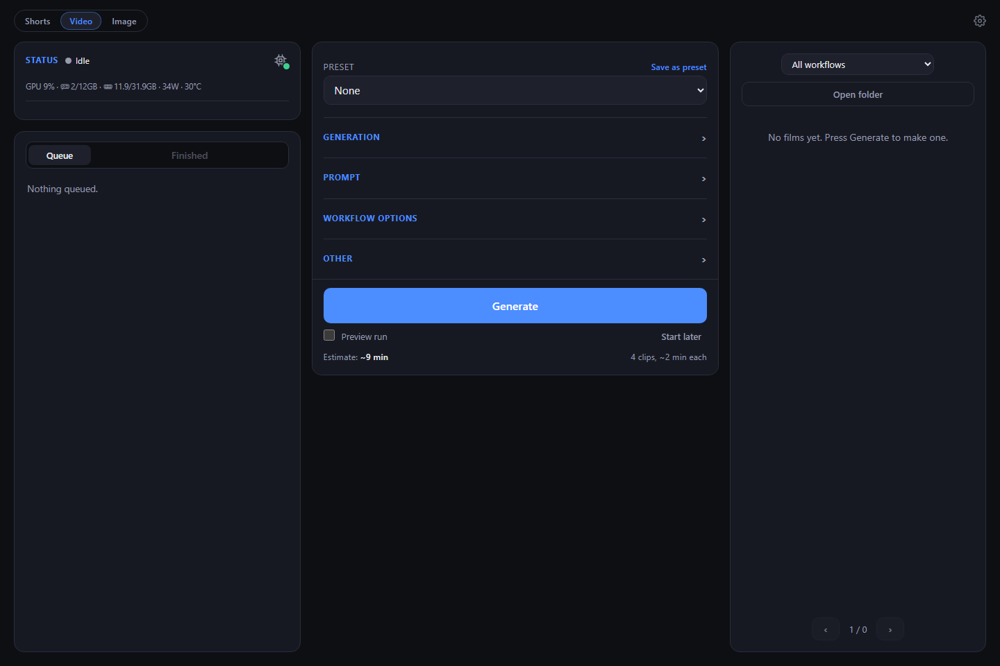
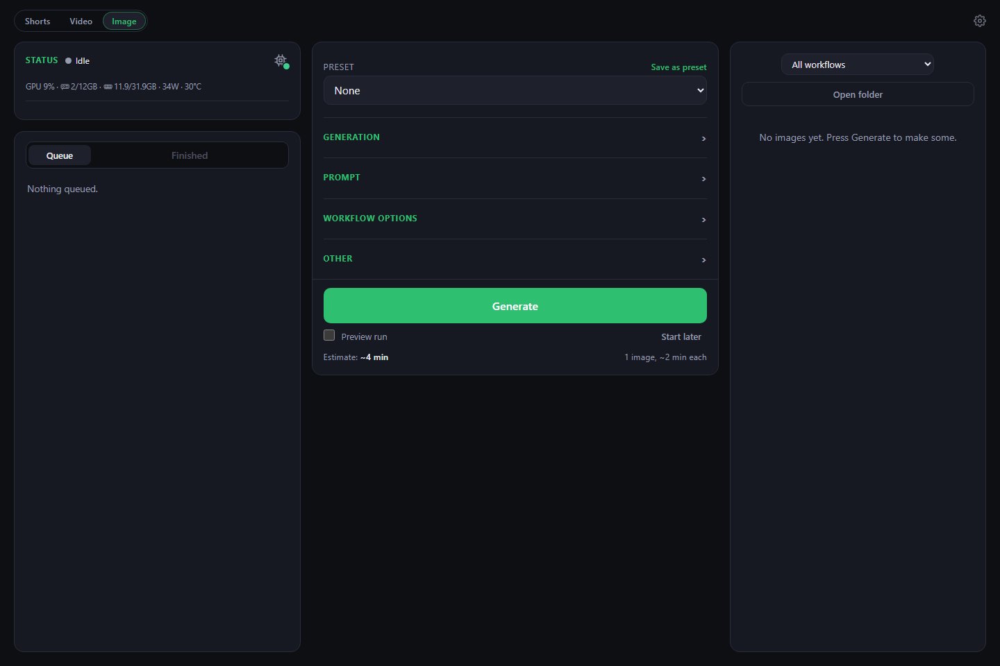

# gen-center

Makes videos and images with ComfyUI from one panel, with three pipelines behind a **Shorts | Video | Image** switch.

| | Shorts | Video | Image |
|---|---|---|---|
| Makes | Vertical YouTube Shorts: AI script, narration, stock footage and a lip-synced presenter | A film of up to 10 minutes from an image and a prompt, whose shot prompts you can read first | A set of up to 100 images, from text or by editing an image, with prompts an LLM writes or your own |
| Audio | Always narrated | None, an uploaded file, or text to speech | None |
| Workflows | Those saved in ComfyUI ending in `_shorts`, which need a Load Audio node | Every other workflow saved in ComfyUI | Those saved in ComfyUI starting `image_` |
| Publishing | Uploads to YouTube | Download only | Download only |
| Details | [docs/shorts.md](docs/shorts.md) | [docs/video.md](docs/video.md) | [docs/image.md](docs/image.md) |

## Screenshots

On a desktop, Status, Generate and the finished films or images sit side by side:





On a phone, one section shows at a time, chosen in the footer:

<p>
  
  
</p>

On a phone, the navigation shows one section at a time: Status, Generate or the videos and images, with a small bar
for what's running when you're elsewhere. Log and Quota are icons at the top of Settings; Finished is beside the
run controls in Status.

Chat (tap Status again, or its icon beside the log) talks with one of the local models. Conversations are kept on the
server (`logs/chats.json`), so they are the same on every device: the new-chat button starts another with an empty
context, Clear empties the open one (the others stay), and Sessions opens an earlier one to carry on (or deletes it). The top right shows how much of the model's context the
conversation takes; tap it for the parts (instruction, conversation, room kept for the reply, free). A local model and a generation can't share the GPU,
so a message sent while one runs goes next in line: the queue starts nothing new, and the reply begins as soon as that
generation is done, ahead of whatever waits in the queue. While a reply is being written, the queue waits for it.

Generate keeps its compact footer controls and estimate visible, including at the end of the form; the former
full-size bottom controls are hidden. Explanatory hints open from small information icons beside their field headings.
The footer estimate shows its label on the first line and the time on the second.
Outer gutters are 8px, with compact gaps between desktop columns to leave more room for the panels.
Click the preset name (or **Preset**) at the right of the Workflow header to select, save, favourite or delete a
preset in its modal. The adjacent reset icon restores the workflow's saved settings; the keep-open pin sits to its right.
Workflow selection stays above the collapsible sections. Section headers stay visible while the open section
scrolls internally, including Queue, Pending and Failed in Status. Opening a section closes the others by default;
the pin keeps multiple generation sections open (highlighted in the current media color), without affecting Status.
Generation and Status accordion headers slide as sections open and close. An open generation section fills the space
to the footer; with everything closed, the headers stack together at the top.
Scrollable content fades into the hard divider above the next header while more content remains below.
The prompt-enhancement LLM picker scrolls within its menu, including gestures over model names and native scrollbar dragging.
Collection rearranging uses the queue's accelerating edge-hold scrolling, both on the collection list and inside
its thumbnail album. Ordinary Queue/Pending/Failed scrolling continues onto the page at either end, and opening
a Status section scrolls its header into view after the accordion animation.
Style LoRA uses one compact checkbox, selector and strength row, without hiding its selector when unchecked.
Saved LoRA filename aliases resolve to an unambiguous installed file, rather than appearing twice in the picker.
LoRAs tagged NSFW or uncensored in their filename or folder are offered only in Private mode; switching modes
updates the pickers while preserving each mode's draft.
The + below Style LoRA adds independently enabled LoRAs, each with its own selector and strength; presets and drafts
keep the stack. Other options offers LoRA Strength and LoRA Style tests for images and videos. Strength tests start
at the chosen legal increment and stop at 2.0; style tests use all compatible LoRAs visible in the current mode.
Combining both tests covers every LoRA/strength pair. Tests vary the first LoRA, keep added LoRAs fixed, use the
current prompt verbatim and one shared seed, and ignore image Amount. Images form one comparison set; videos are
separate queued generations at the current duration.
Queue's sort icon beside its chevron orders waiting jobs by shortest ETA, with unknown estimates last. Removing
the last Finished entry closes Finished after the removal succeeds.
Workflow and Style LoRA guides open from the hint icons beside their headings, rather than links below the controls.
Image and Video both offer a local prompt-model selector. When titling is enabled, a local model selected for the
generation (including the prompt editor's local writer) also supplies its title instead of Gemini; with no local
generation model, the configured title source and default model apply. Titles set to Off remain off.
The empty progress-header strip collapses when there is no progress to show; Settings and Private mode remain accessible.
Saving a preset uses a name field in the modal, with visible saving/error feedback and confirmation before overwriting
an existing name. Applying a preset asks before clearing a nonempty prompt.
Normal and Private mode have separate generation drafts in the open tab: prompts (including negative prompts),
loaded images/video/audio, painted regions and queued-edit context return when you switch back. Presets and
application settings stay shared. Private drafts are held in page memory, not browser storage; refreshing or
closing the page discards them. Late prompt/media-loading replies from the previous mode are ignored.
Unreadable cached workflow options are logged and output metadata falls back to the saved workflow, so old results
do not block the panel from loading. Open the panel with ComfyUI on to refresh those cached options.
Connection failures show a reconnecting message, the last successful update and **Retry now**, rather than leaving
an endless loading bar. Individual page-update failures are also visible while unaffected sections keep updating.
The reconnecting notice fades and slides beneath the loading bar, overlaying the page without shifting its layout.
The page requests a versioned output catalogue: unchanged galleries are not resent with each status poll.
Output scans are shared for up to ten seconds while idle, two seconds while generating, and invalidated by
successful panel mutations. External filesystem changes therefore appear within that interval.

The panel's JavaScript lives in `panel/static/`, grouped by generation, workflow options, painting, galleries,
queues/status, drafts/navigation and the prompt editor. `index.html` supplies only markup, styles and a JSON
configuration block. Deferred classic scripts retain shared bindings and load in the template's explicit order;
`startup.js` runs last. Keep initialization there when adding behavior that depends on another topic.

**Clear** in Finished removes only the displayed batches, leaving hidden results and jobs that finish afterward.
In the mobile header, Finished sits before Privacy and turns red if its list contains a failure; Privacy highlights purple.
In Privacy mode, private image/video entries in Running, Queue, Pending and Failed have a small purple privacy pill
at the top left. Untagged entries offer the same two-tap private-tag button as Output, so you can mark a run private
before it finishes, in either mode. The tag is kept through queue edits and retries and applies to its output;
the privacy pills are hidden outside Privacy mode.
In Output, **Arrange batches** lets you tap a batch and drag it (or use the up/down arrow keys).
The arrangement is saved for all devices; new generations still appear above older batches.
Deleting in preview opens the next item, or the previous one at the end; the delete icon pulses yellow while waiting.
Moving an item to a collection keeps the selected destination's neutral background, using purple borders and
completion feedback instead of a colored fill. Private-collection warning borders remain distinct.

The log groups its lines by stage; each stage heading shows its outcome (clips done, failures, time) and opens or
closes with a tap. **Summary** (the default) folds a clip's seed and render lines into one line, sums up the stock
footage, and cuts long prompts short with a *Show full prompt* button. Warnings and failures stay visible even in a
closed stage. **Detailed** shows every line as printed. The **ComfyUI** and **Errors** filters work in both.

They share one queue, because there is one GPU, and a job started on either side shows on both. They also share one
record of API use: when a provider says a model is used up for the day, every run moves to the next model until the
reset that reply gave (`logs/exhausted_models.json`).

Each queue saves waiting work, current work, finished results and its next identifier together in a versioned,
atomically replaced ledger (`logs/queue_runs_state.json` and `logs/queue_uploads_state.json`). Legacy queue/result
files migrate without being deleted. Interrupted work returns on hold after a restart; Pending does not expire.
An unreadable ledger blocks execution and logs its path for repair rather than starting an empty queue over it.
An OS-held ownership lock prevents a second panel process from starting GPU work against the same application data.

**Add to top of queue** puts the job first without starting it when idle; resume the queue when ready. While a job is
running, it will run next. **Generate** starts a job directly when idle.

An aimdo memory-compile error or explicit exit-1 error stops a stuck generation immediately, restarts ComfyUI,
and retries the saved work once. If it fails again, it goes to Failed and ComfyUI restarts for the next job.

Nothing is paid for twice. **Generate** continues stopped work that matches: on Shorts the video on the topic you typed,
or the oldest with the topic empty; on Video the same brief, images, audio and length; on Image the same brief, images, count and workflow. The options on the form apply,
and only what they change is done again.

Run checkpoints use a versioned `state.json`; older unversioned runs still load. A damaged or newer-version
checkpoint reports its path instead of appearing missing. Catalogue scans isolate unreadable runs and list each
under Failed with expandable error details; valid runs and new generations remain usable. Damaged files are never silently overwritten:
restore a valid backup to recover that specific run. Checkpoints include provenance observed when saved:
available workflow and map bytes and SHA-256 hashes, settings, and available package versions. This does not
assert model-file hashes or reconstruct earlier settings for old runs. Finished Shorts retain their manifest in
`runs/shorts/manifests/<run-id>.json` after their working folder is removed.
Catalogue and continuation-candidate scans isolate unreadable checkpoints, logging their paths and retaining
errors for status reporting; unrelated valid runs remain available. Directly resuming a damaged run still fails
with repair/restore guidance. No damaged checkpoint is automatically overwritten, removed or quarantined.
An unreadable run's delete button removes its run folder and its files after two taps; output files outside that
folder are left untouched. A folder listing error cannot be deleted from the panel.

## Setup

You need Python 3.11+, ffmpeg on the PATH, and ComfyUI with the models your workflows use.

```
pip install -r requirements.txt
cp .env.example .env
```

Fill in `.env`. `APP_PASSWORD` lets you reach the panel from a phone. `COMFYUI_LAUNCHER` lets the panel start ComfyUI.

For local LLMs and verified between-job/OOM cleanup, install the ComfyUI integration with
`python scripts/install_comfy_cleanup.py` (or supply `--comfy-root`), then restart ComfyUI when idle.
Cleanup waits for ComfyUI's worker to unload models, reset node caches, collect garbage, synchronize CUDA,
release cuBLAS workspaces and clear its GPU cache. It uses PyTorch's internal cuBLAS workspace-release hook,
also used by PyTorch's memory-leak checks; unsupported versions fail explicitly rather than skipping cleanup.
The panel checks the acknowledgement and GPU allocation measurements before proceeding; it holds generation
while between-job cleanup is running and parks the queue if cleanup fails. Available VRAM is recorded when
starting a local LLM. This verifies ComfyUI's cleanup, not other applications' GPU use or an LLM's total memory needs.

### Reproducible installs and validation

For the Windows x64 / Python 3.13 baseline, use:

```
python -m pip install -r requirements.txt -c constraints-windows-py313.txt
python -m pip check
```

The constraints pin the installed application dependency closure, not unrelated development tools. They are
specific to that platform/runtime; Python 3.11 remains supported through the normal requirements resolver.
Upgrade deliberately in a clean environment, check dependency compatibility, run the suites, and update the
constraints together with the change rather than upgrading an existing generation environment blindly.

GitHub Actions runs the unit/integration suites and headless Chromium checks on Windows with Python 3.11 and 3.13.
The browser checks cover connection animation/recovery, desktop/mobile accordion headers, inline LoRA controls,
prompt-editor model handoff, inline preset errors and private-draft isolation. They require
`requirements-dev.txt`, `python -m playwright install chromium` and `GEN_CENTER_BROWSER_TESTS=1`; otherwise that
optional test is skipped. In VS Code, run tests through Test Explorer or the existing silent test tasks, and close
their processes afterward. Tests use disposable application data and fake services, not live generations.
The silent `browser-tests` task prepares the constrained development dependencies and Chromium before running
the opt-in checks. The `all-tests` task retains its output in `logs/all-tests.log` when its terminal closes.

The Node page checks execute the external frontend scripts separately in production load order.
The sign-in page's behavior is isolated in `panel/static/login.js`.

## Running it

```
powershell -ExecutionPolicy Bypass -File scripts/create_shortcut.ps1
```

That makes a **gen-center** shortcut, which starts the panel and opens it at http://localhost:8800. `/shorts`,
`/video` and `/image` open each side directly. **Shut down** in Settings stops it. Or run `python webapp.py --host 0.0.0.0 --port 8800`.

To start the panel without opening a browser when you sign in to Windows, run
`powershell -ExecutionPolicy Bypass -File scripts\create_shortcut.ps1 -Startup`. Remove the **gen-center**
shortcut from Windows' Startup folder to disable it.

**From your phone, anywhere:** install [Tailscale](https://tailscale.com/download) on this PC and your phone and sign
in to the same account on both. Starting the panel also starts Tailscale and reconnects it if it was off. Settings shows the address to open on your phone, `http://100.x.y.z:8800`, which stays the same, so it's worth
bookmarking. Tailscale encrypts the connection, and only your own devices can reach it. `python webapp.py` on its own
only listens to this PC and leaves Tailscale alone: add `--host 0.0.0.0`.

Each pipeline also runs alone: `python -m pipelines.shorts.main --help`, `python -m pipelines.video.main --help` and `python -m pipelines.image.main --help`.

## Settings

The gear in the header opens Settings:

- **Theme**: choose the standard appearance or one of 15 other dark palettes, with color previews. The choice is saved for all devices.
- **Restart**, **Comfy**, **Force** and **Power** stay at the bottom of Settings. Restart and Comfy need a second tap;
  Comfy starts it when off. Force takes three taps and can interrupt a run. Power opens **Log out**; tap Power again to
  confirm shutting down the panel. Starting ComfyUI manually stops local processes first, including renders started
  outside the panel, then launches a fresh instance. It refuses while panel work is active or about to start.
- **Reserve free RAM** (3 to 12 GB): start ComfyUI with `--cache-ram`, so the PC stays responsive. Press **Set**, then
  restart ComfyUI. It only applies to a ComfyUI the panel starts. 3 is ComfyUI's own default, so nothing is added.
- **Run generation at lower priority**, so the PC stays usable while it renders.
- **Shut down the PC when the queue is empty**: for this session only, never saved. Windows waits a minute before it
  shuts down, and unticking it or starting new work cancels it. A held queue counts as work.
- **Default workflow** for each side, the phone and Tailscale addresses with copy buttons, and the disk space left for output.

On Windows, the panel checks GPU temperature every three seconds, even with no browser open.
Above **78°C**, it restarts the current user's MSI Afterburner once to recover fan control.
It re-arms after cooling to **75°C** or below. Afterburner must be running or installed under Program Files;
restart failures appear in the generation log. This is recovery assistance, not a thermal safety shutdown.

## Layout

```
core/         what the pipelines share: Gemini calls, API usage and quota, voice, saved workflows
pipelines/    shorts/, video/ and image/, each with its own command line, runs and ETA
panel/        the web app: server.py is shared, shorts.py, video.py and image.py hold each side's options
workflows/    the built-in workflows
docs/         each pipeline in detail
logs/         usage, errors, topics and timings
models/       what the panel runs itself on the CPU, for Select: python scripts/get_models.py
runs/         saved progress, by pipeline
output/       shorts/ready, shorts/uploaded, shorts/bad, video and image
```

## Tests

VS Code's Testing view discovers the full unittest suite under `tests`. Run individual tests, classes or the full
suite there; use **Test: Refresh Tests** if the list has not updated.
Alternatively, run **Tasks: Run Test Task** and choose **all-tests**. The tests run in the integrated terminal, which
closes when they finish.
**relevant-panel-tests** covers the panel script, compact preset header, workflow metadata recovery, privacy tagging,
Finished, batch ordering and crash/heat recovery. **prompt-feature-tests** covers prompt writing, clip planning and H3 modes.
All three are ordinary Python unittest tasks with output in VS Code's integrated terminal; no standalone windows open.

They use a fake ComfyUI and Gemini on localhost, real ffmpeg, and a throwaway folder. Nothing costs anything.

## History

This joins two earlier projects, kept as archives: [auto-yt-shorts](https://github.com/jwlei/auto-yt-shorts) and auto-comfyui.
