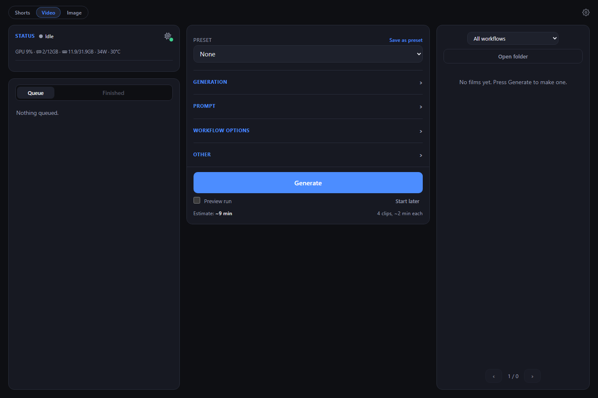
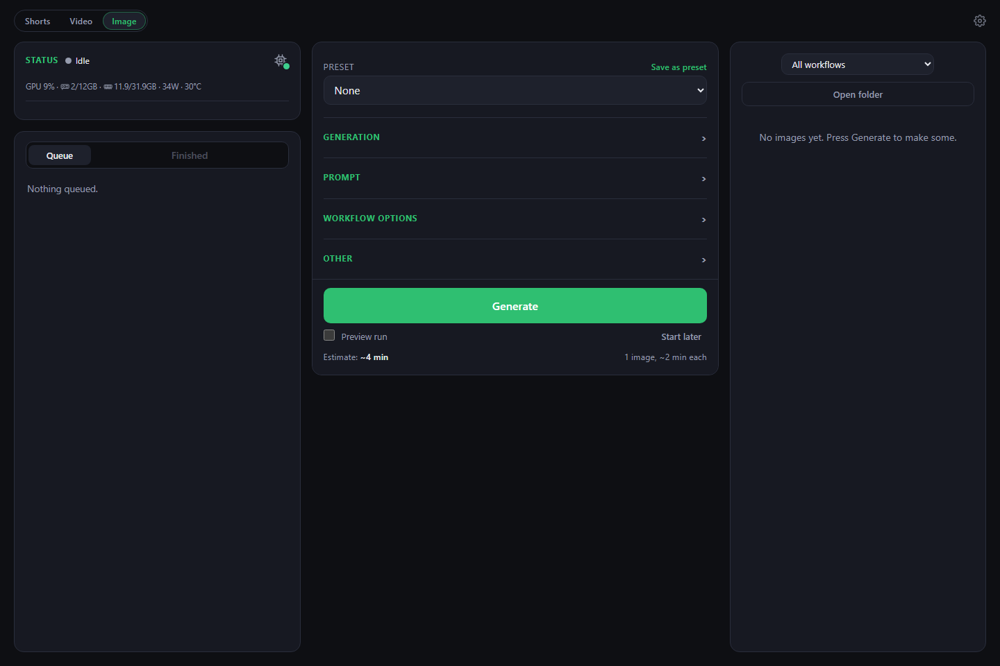
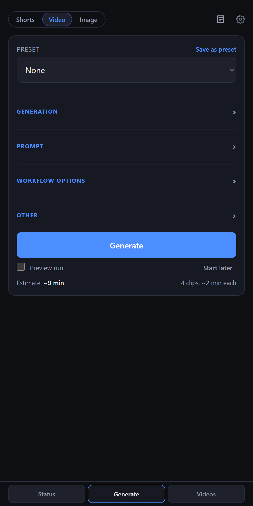
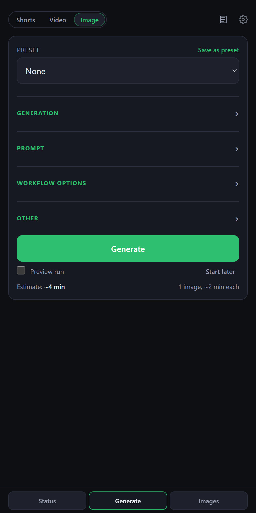

# gen-center

Makes videos and images with ComfyUI from one panel, with three pipelines behind a **Shorts | Video | Image** switch.

| | Shorts | Video | Image |
|---|---|---|---|
| Makes | Vertical YouTube Shorts: AI script, narration, stock footage and a lip-synced presenter | A film of up to 10 minutes from an image and a prompt, whose shot prompts you can read first | A set of up to 100 images, from text or by editing an image, with prompts an LLM writes or your own |
| Audio | Always narrated | None, an uploaded file, or text to speech | None |
| Workflows | Those saved in ComfyUI ending in `_shorts`, which need a Load Audio node | Every other workflow saved in ComfyUI | Those saved in ComfyUI starting `image_` |
| Publishing | Uploads to YouTube | Download only | Download only |
| Details | [docs/shorts.md](docs/shorts.md) | [docs/video.md](docs/video.md) | [docs/image.md](docs/image.md) |

## Screenshots

On a desktop, Status, Generate and the finished films or images sit side by side:





On a phone, one section shows at a time, chosen in the footer:

<p>
  
  
</p>

On a phone, the navigation shows one section at a time: Status, Generate or the videos and images, with a small bar
for what's running when you're elsewhere. Log and Quota are icons at the top of Settings; Finished is beside the
run controls in Status.

The log groups its lines by stage; each stage heading shows its outcome (clips done, failures, time) and opens or
closes with a tap. **Summary** (the default) folds a clip's seed and render lines into one line, sums up the stock
footage, and cuts long prompts short with a *Show full prompt* button. Warnings and failures stay visible even in a
closed stage. **Detailed** shows every line as printed. The **ComfyUI** and **Errors** filters work in both.

They share one queue, because there is one GPU, and a job started on either side shows on both. They also share one
record of API use: when a provider says a model is used up for the day, every run moves to the next model until the
reset that reply gave (`logs/exhausted_models.json`).

Nothing is paid for twice. **Generate** continues stopped work that matches: on Shorts the video on the topic you typed,
or the oldest with the topic empty; on Video the same brief, images, audio and length; on Image the same brief, images, count and workflow. The options on the form apply,
and only what they change is done again.

## Setup

You need Python 3.11+, ffmpeg on the PATH, and ComfyUI with the models your workflows use.

```
pip install -r requirements.txt
cp .env.example .env
```

Fill in `.env`. `APP_PASSWORD` lets you reach the panel from a phone. `COMFYUI_LAUNCHER` lets the panel start ComfyUI.

## Running it

```
powershell -ExecutionPolicy Bypass -File scripts/create_shortcut.ps1
```

That makes a **gen-center** shortcut, which starts the panel and opens it at http://localhost:8800. `/shorts`,
`/video` and `/image` open each side directly. **Shut down** in Settings stops it. Or run `python webapp.py --host 0.0.0.0 --port 8800`.

**From your phone, anywhere:** install [Tailscale](https://tailscale.com/download) on this PC and your phone and sign
in to the same account on both. Starting the panel also starts Tailscale and reconnects it if it was off. Settings shows the address to open on your phone, `http://100.x.y.z:8800`, which stays the same, so it's worth
bookmarking. Tailscale encrypts the connection, and only your own devices can reach it. `python webapp.py` on its own
only listens to this PC and leaves Tailscale alone: add `--host 0.0.0.0`.

Each pipeline also runs alone: `python -m pipelines.shorts.main --help`, `python -m pipelines.video.main --help` and `python -m pipelines.image.main --help`.

## Settings

The gear in the header opens Settings:

- **Restart panel**, **Restart ComfyUI** and **Shut down**, each confirmed with a second tap. When ComfyUI is off, the
  restart button reads **Start ComfyUI**. Starting it manually stops local ComfyUI processes first, including renders
  started outside the panel, then launches a fresh instance. It refuses while panel work is active or about to start.
- **Reserve free RAM** (3 to 12 GB): start ComfyUI with `--cache-ram`, so the PC stays responsive. Press **Set**, then
  restart ComfyUI. It only applies to a ComfyUI the panel starts. 3 is ComfyUI's own default, so nothing is added.
- **Run generation at lower priority**, so the PC stays usable while it renders.
- **Shut down the PC when the queue is empty**: for this session only, never saved. Windows waits a minute before it
  shuts down, and unticking it or starting new work cancels it. A held queue counts as work.
- **Default workflow** for each side, the phone and Tailscale addresses with copy buttons, and the disk space left for output.

## Layout

```
core/         what the pipelines share: Gemini calls, API usage and quota, voice, saved workflows
pipelines/    shorts/, video/ and image/, each with its own command line, runs and ETA
panel/        the web app: server.py is shared, shorts.py, video.py and image.py hold each side's options
workflows/    the built-in workflows
docs/         each pipeline in detail
logs/         usage, errors, topics and timings
models/       what the panel runs itself on the CPU, for Select: python scripts/get_models.py
runs/         saved progress, by pipeline
output/       shorts/ready, shorts/uploaded, shorts/bad, video and image
```

## Tests

```
python -m unittest discover tests
```

They use a fake ComfyUI and Claude on localhost, real ffmpeg, and a throwaway folder. Nothing costs anything.

## History

This joins two earlier projects, kept as archives: [auto-yt-shorts](https://github.com/jwlei/auto-yt-shorts) and auto-comfyui.
